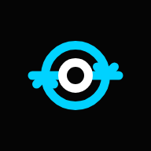

<div align="center">

# ⚡ ENRIQUE NDJAKOU

### **Élève-Ingénieur en Génie Électrique & Systèmes Embarqués · Polytech Lille (2026)**
**Apprenti Ingénieur en Automatisme, Supervision SCADA & Informatique Industrielle · Minakem Dunkerque**

[](https://portfolio.enriquekemayou.workers.dev)
[](https://nextjs.org)
[](https://react.dev)
[](https://www.typescriptlang.org)
[](https://tailwindcss.com)
[](https://cloudflare.com)
[](LICENSE)

<br />

<p align="center">
  <a href="#-profil-industriel--positionnement">Profil</a> •
  <a href="#-projets-dingénierie-phares">Projets Clés</a> •
  <a href="#-architecture-technique--innovations">Architecture Web</a> •
  <a href="#-identit%C3%A9-de-marque--the-feedback-core">Identité Visuelle</a> •
  <a href="#-installation--d%C3%A9veloppement-local">Développement Local</a> •
  <a href="#-contact--coordonn%C3%A9es">Contact</a>
</p>

---

</div>

## 📌 Profil Industriel & Positionnement

Élève-ingénieur en dernière année à **Polytech Lille** (cursus Génie Électrique & Informatique Industrielle / Systèmes Embarqués & Mécatronique, Promotion 2026), j'évolue en apprentissage au sein de l'usine chimique pharmaceutique **Minakem Dunkerque**, classée **SEVESO Seuil Haut**.

Mon activité industrielle et académique s'articule autour de contraintes matérielles sévères : disponibilité critique, temps réel strict, sûreté de fonctionnement et intégrité des communications de terrain.

### Domaines d'expertise :
- **Automatisme & Séquencement** : Modélisation Grafcet (CEI 60848, CEI 61131-3), automates programmables industriels (Schneider Electric, Siemens), instrumentation de terrain.
- **Supervision & SCADA** : Déploiement et migration de plateformes SCADA critiques (Ignition v8.1 Vision/Perspective, Wonderware InTouch), gestion de bases UDT, historisation SQL, alarmes temps réel.
- **Régulation Avancée & Contrôle-Commande** : Synthèse de correcteurs continus et numériques (P, PI, PID, régulation en cascade), modélisation d'état, Hardware-in-the-Loop (HIL) sur cibles industrielles **Speedgoat** avec **Matlab/Simulink**.
- **Bus de Terrain & Protocoles Industriels** : Modbus RTU sur liaison RS-485 bifilaire, Modbus TCP sur passerelles industrielles (Moxa MB3170), OPC-UA, CAN, boucles essernet (Honeywell Esser SEI2), USART, Ethernet industriel.
- **Informatique Embarquée & Bas Niveau** : Programmation en C/C++ ISO, assembleur nu AVR8 sur microcontrôleur ATMEGA2560 (gestion directe des registres matériels, vecteurs d'interruption, timers 16 bits, convertisseur ADC sans aucune abstraction logicielle).
- **Électronique Active & CAO** : Conception, simulation sous **LTSpice**, routage sous **KiCad** (plans de masse, contraintes CEM, découplage), usinage CNC et soudure de composants CMS (filtres actifs d'ordre 4 Sallen-Key).

---

## 🛠️ Projets d'Ingénierie Phares

Ce dépôt héberge le code source du portfolio interactif présentant l'ensemble de mes réalisations techniques vérifiables :

| Projet | Domaine Technique | Cible / Environnement | Métriques & Réalisations Clés |
| :--- | :--- | :--- | :--- |
| **[Contrôle-Commande Bicuve](https://portfolio.enriquekemayou.workers.dev/projects/controle-hydraulique-bicuve-2026)** | Automatique & Régulation | HIL Speedgoat · Matlab / Simulink | Régulation cascade double boucle. Identification indicielle, discrétisation par transformation bilinéaire ($T_e = 10\text{ ms}$). Temps de réponse divisé par 4, erreur statique rigoureusement nulle sous perturbation. |
| **[Supervision SSI SEVESO](https://portfolio.enriquekemayou.workers.dev/#experience)** | SCADA & Réseaux Industriels | Ignition v8.1 · Moxa MB3170 · Esser SEI2 | Intégration de 23 centrales incendie Esser FlexES. Conversion essernet vers Modbus RTU (RS-485, 9600 bps, 8N1) et encapsulation Modbus TCP sur VLAN automatisme. Scrutation 500 ms, UDTs structurés, historisation SQL Server. |
| **[Filtre Actif de Tchebychev](https://portfolio.enriquekemayou.workers.dev/projects/filtre-tchebychev-2026)** | Électronique Analogique | KiCad · LTSpice · Gravure CNC | Filtre passe-bas actif d'ordre 4 (cellules Sallen-Key). Bande passante $4,5\text{ kHz}$, ondulation $\le 1\text{ dB}$, atténuation effective de $35\text{ dB}$ à $13\text{ kHz}$ validée à l'oscilloscope numérique. |
| **[Robot Mobile Robotino](https://portfolio.enriquekemayou.workers.dev/projects/robotino-hockey-autonome-2026)** | Robotique & Systèmes Embarqués | Robotino 2 · Grafcet · Vision HSV | Match de hockey autonome. Suivi de palet invariant aux variations d'éclairage en espace HSV, odométrie à 2000 impulsions/tour pour anticipation du freinage et détection de ligne par capteur inductif (portée 4 mm). |
| **[Microprocesseurs ATMEGA2560](https://portfolio.enriquekemayou.workers.dev/projects/microprocesseurs-atmega2560-2026)** | Informatique Bas Niveau | Assembleur AVR8 pur · ATMEGA2560 | 3 systèmes critiques programmés au niveau registres sans runtime C : gestionnaire d'interruption en mode veille profonde (0 polling), thermomètre distant (ADC + port parallèle + USART synchrones), alarme intrusion. |
| **[Lyngk – Moteur Hexagonal](https://portfolio.enriquekemayou.workers.dev/projects/lyngk-moteur-jeu-c-2026)** | Algorithmique & Systèmes C | C pur · SDL3 · Architecture MVC | Modélisation du plateau hexagonal en coordonnées axiales via bitmasking 64 bits (43 cases traitées en 1 cycle machine). Algorithme DFS pour calcul de trajectoires. 0 fuite mémoire sous `-Wall -Wextra`. |
| **[Shell Unix Natif](https://portfolio.enriquekemayou.workers.dev/projects/interpreteur-commandes-unix-2025)** | Systèmes d'Exploitation | C POSIX · Linux Kernel API | Émulateur de terminal exploitant directement `fork`, `execvp`, `dup2` et `pipe`. Gestionnaire déterministe de signaux asynchrones pour l'isolation des processus zombies et des flux I/O. |
| **[Awale – Stratégie Combinatoire](https://portfolio.enriquekemayou.workers.dev/projects/awale-jeu-c-2026)** | Algorithmique & Systèmes | C ISO · Arithmétique Modulaire | Modélisation d'un plateau cyclique sous contrainte mémoire stricte. Arithmétique modulaire, pointeurs de fonctions, structures contiguës, espace mémoire strictement borné. |
| **[PyGroove – Assistant Audio](https://portfolio.enriquekemayou.workers.dev/projects/pygroove-assistant-audio-2025)** | Génie Logiciel & Audio | Python · Tkinter · Pygame · Speech-Rec | Architecture multi-threadée isolant les flux I/O asynchrones, la reconnaissance vocale et le buffer DMA matériel de la carte son. |
| **[Simulateur Agricole C++](https://portfolio.enriquekemayou.workers.dev/projects/simulateur-agricole-poo-2024)** | POO & Patrons de Conception | C++ ISO · Smart Pointers · Polymorphisme | Modélisation d'un environnement systémique en graphe circulaire. Élimination des pointeurs orphelins par comptage de références (`std::shared_ptr`/`std::weak_ptr`). |
| **[Moteur Snake Arcade](https://portfolio.enriquekemayou.workers.dev/projects/moteur-jeu-snake-cpp-2024)** | Algorithmique Temps Réel | C++ ISO · Game Loop Déterministe | Gestion temps réel de la boucle d'affichage 60 FPS, détection collisionnelle discrète sans surcharge processeur. |

---

## ⚡ Architecture Technique & Innovations du Portfolio

Le portfolio n'est pas une vitrine statique : c'est une application d'ingénierie full-stack réactive, optimisée pour des temps de réponse sub-100ms et un score Core Web Vitals parfait.

```
┌────────────────────────────────────────────────────────────────────────┐
│                        FRONTEND CLIENT (EDGE)                          │
│                                                                        │
│   Next.js 16 (App Router)  │  React 19  │  Tailwind CSS v4 (Oxide)     │
│   Framer Motion (Physics)  │  Three.js (GPU Particle Canvas)           │
│   DualBodyCursor (Fine)    │  SideSlider (Obsidian Mechatronic Bar)    │
└───────────────────────────────────┬────────────────────────────────────┘
                                    │ HTTPS / HTTP2 Edge Routing
                                    ▼
┌────────────────────────────────────────────────────────────────────────┐
│                     CLOUDFLARE EDGE PLATFORM                           │
│                                                                        │
│   Cloudflare Pages (@opennextjs/cloudflare runtime)                    │
│   Cloudflare D1 (Serverless Distributed SQLite Engine)                 │
│   Cloudflare R2 (Global Object Storage for Media Assets)               │
│   Edge Security (Strict CSP Headers, Frame-Ancestors DENY, Rate-Limit) │
└────────────────────────────────────────────────────────────────────────┘
```

### 1. DualBodyCursor & Physique Cinématique
- Détection fine de l'interface d'entrée : activé uniquement sur les périphériques de pointage de précision via `(pointer: fine)` ; strictement désactivé sur écrans tactiles, stylets et mobiles pour préserver l'ergonomie native de défilement.
- Amortissement inertiel : interpolation continue entre position cible $(x, y)$ et position amortie par équation différentielle d'ordre 1 avec amortissement critique.
- Curseur double corps : tête de visée centrale blanche haute précision et anneau suiveur cyan `#00D2FF` traduisant visuellement la dynamique d'une boucle fermée d'asservissement.

### 2. SideSlider Mécatronique
- Barre de défilement latérale haute précision en verre obsidienne (`#050505`) et traceur cyan (`#00D2FF`).
- Suivi bidirectionnel de position verticale avec calcul d'interpolation linéaire (`lerp`), capsule interactive draggable et micro-badge HUD monospace.
- Présence continue et persistante sur l'ensemble de la page (y compris la section compétences) avec isolation stricte du pointeur (`cursor: none !important`) interdisant tout retour à la flèche OS classique.

### 3. Stack Données & Déploiement Edge Serverless
- **Next.js 16 App Router** : Rendu hybride (Server Components statiques et Client Components interactifs) éliminant tout décalage d'agencement (`CLS: 0.00`).
- **Tailwind CSS v4** : Compilation directe via le moteur Rust Oxide, syntaxe moderne `@theme` et isolation complète des styles tiers.
- **Cloudflare D1** : Base de données relationnelle SQLite distribuée sur le réseau Anycast mondial, gérée par des migrations SQL versionnées (`migrations/0001` à `0006`).
- **Sécurité Industrielle** : Politique de sécurité de contenu stricte (`Content-Security-Policy`), en-têtes anti-clickjacking (`X-Frame-Options: DENY`), isolation cross-origin (`COOP` et `CORP`), et limitation de débit sur les routes d'authentification (`0004_login_rate_limit.sql`).

---

## 💎 Identité de Marque : The Feedback Core

L'identité visuelle du portfolio repose sur le **Concept 1 : The Feedback Core / La Boucle Fermée**, conçu pour matérialiser les principes de l'automatique et de la mécatronique :

<div align="center">
  
</div>

- **Le Noyau Central (`cx=12, cy=12, r=3`)** : Représente le procédé physique (la plante) et le nœud sommateur du régulateur PID.
- **Vecteur de Consigne ($w(t)$)** : Tracé horizontal gauche orienté vers le nœud sommateur.
- **Vecteur de Sortie Asservie ($y(t)$)** : Tracé horizontal droit propageant la grandeur réglée vers le système aval.
- **Branche Directe Supérieure ($G(s)$)** : Arc de transfert direct orienté vers la sortie avec flèche terminale.
- **Boucle de Retour Inférieure ($H(s)$)** : Arc de rétroaction du capteur ramenant l'information vers le comparateur d'entrée.

### Suite Multi-Résolution & PWA Mobile
Pour garantir une netteté absolue et éradiquer tout résidu d'icône par défaut sur les navigateurs mobiles et desktop :
- **iOS Safari / iPadOS** : `public/apple-touch-icon.png` (180x180 px PNG plein fond obsidienne `#050505`, zone de sécurité adaptée au masque squircle d'Apple).
- **Android Chrome & PWA** : `public/icon-192.png` et `public/icon-512.png` accompagnés de versions maskables (`icon-maskable-192.png`, `icon-maskable-512.png`) garantissant la conformité avec la safe-zone circulaire de 80%.
- **Navigateurs Desktop** : `favicon.ico` multi-résolution encapsulant des calques 16x16, 32x32 et 48x48 px, couplé à `icon.svg` vectoriel.

---

## 💻 Installation & Développement Local

### Prérequis
- **Node.js** : version $\ge 20.0.0$
- **npm** : version $\ge 10.0.0$
- **Python** (optionnel, pour l'outillage de génération vectorielle) : $\ge 3.10$

### 1. Clonage du dépôt
```bash
git clone https://github.com/enrique-alex/portfolio.git
cd portfolio
```

### 2. Installation des dépendances
```bash
npm install --legacy-peer-deps
```

### 3. Lancement du serveur de développement
```bash
npm run dev
```
L'application est accessible localement à l'adresse [http://localhost:3000](http://localhost:3000).

### 4. Exécution de la suite de tests
La suite de tests automatisés valide la conformité géométrique des composants vectoriels, la configuration PWA, la sécurité des sessions et les algorithmes d'asservissement :
```bash
npm test
```

### 5. Build et prévisualisation Cloudflare Pages
```bash
# Compilation du worker OpenNext pour Cloudflare
npm run build:cloudflare

# Prévisualisation en environnement local simulé Cloudflare Workerd
npm run preview
```

---

## 📁 Structure du Projet

```
portfolio/
├── migrations/                     # Schémas relationnels Cloudflare D1 (0001 à 0006)
│   ├── 0001_init_projects.sql
│   ├── 0002_split_translations.sql
│   ├── 0003_seed_projects.sql
│   └── ...
├── public/                         # Assets statiques & icônes multi-résolution
│   ├── apple-touch-icon.png       # 180x180 PNG pour iOS Safari
│   ├── icon-192.png               # 192x192 PNG standard Android PWA
│   ├── icon-512.png               # 512x512 PNG haute définition PWA
│   ├── icon-maskable-192.png      # 192x192 PNG maskable adaptive
│   ├── icon-maskable-512.png      # 512x512 PNG maskable adaptive
│   ├── favicon.ico                # ICO multi-résolution (16, 32, 48 px)
│   ├── icon.svg                   # SVG vectoriel officiel
│   └── image/projects/            # Médias et captures des bancs d'essai réels
├── scripts/                        # Scripts d'automatisation et de build
│   ├── generate-brand-icons.py    # Générateur d'icônes Chromium headless & Pillow
│   ├── generate-seed-sql.ts       # Synchronisation des projets vers SQL D1
│   └── generate-admin-secrets.mjs # Génération des clés de dérivation PBKDF2
├── src/
│   ├── app/                       # Next.js 16 App Router
│   │   ├── (site)/                # Routes publiques (accueil, vue projet [slug])
│   │   ├── admin/                 # Console de gestion restreinte
│   │   ├── api/                   # Serverless API routes (projets, uploads R2)
│   │   ├── layout.tsx             # Layout racine, balises de métadonnées et CSP
│   │   ├── manifest.ts            # Manifest WebApp PWA typé
│   │   └── globals.css            # Styles maîtres Tailwind v4
│   ├── components/                # Architecture de composants React 19
│   │   ├── animations/            # DualBodyCursor, KineticCanvas, Preloader
│   │   ├── sections/              # Hero, AcademicJourney, Projects, Contact
│   │   ├── theme/                 # Providers (Theme, Language fr/en, Projects)
│   │   └── ui/                    # Logo Feedback Core, SideSlider, Badges
│   └── lib/                       # Utilitaires de session, cryptographie, D1 client
└── test/                          # Suite de tests Vitest (unit & integration)
    ├── unit/                      # Tests unitaires composants, logo, curseurs
    └── integration/               # Tests d'intégration bases de données D1
```

---

## 📬 Contact & Coordonnées

- **Ingénieur** : Enrique Alex Ndjakou Kemayou
- **École** : Polytech Lille — Département Génie Électrique & Informatique Industrielle
- **Entreprise** : Minakem Dunkerque (Site chimique pharmaceutique SEVESO Seuil Haut)
- **Portfolio en ligne** : [https://portfolio.enriquekemayou.workers.dev](https://portfolio.enriquekemayou.workers.dev)
- **LinkedIn** : [linkedin.com/in/enrique-alex-ndjakou](https://www.linkedin.com/in/enrique-alex-ndjakou)
- **GitHub** : [@enrique-alex](https://github.com/enrique-alex)
- **Email** : [enriquekemayou@gmail.com](mailto:enriquekemayou@gmail.com)

---

<div align="center">
  <sub>Conçu et maintenu par Enrique Ndjakou · Polytech Lille / Minakem · 2026</sub>
</div>
