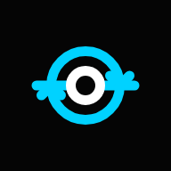

<div align="center">

# ENRIQUE NDJAKOU

### **Élève-Ingénieur en Génie Électrique & Mécatronique · Polytech Lille (2028)**
**Apprenti Ingénieur en Automatisme, Supervision SCADA & Informatique Industrielle · Minakem Dunkerque**

[](https://portfolio.enriquekemayou.workers.dev)
[](https://nextjs.org)
[](https://react.dev)
[](https://www.typescriptlang.org)
[](https://tailwindcss.com)
[](https://cloudflare.com)
[](LICENSE)

<br />

<p align="center">
  <a href="#profil-industriel-et-positionnement">Profil</a> •
  <a href="#projets-dingenierie-et-systemes-15">Projets Clés</a> •
  <a href="#architecture-technique-du-portfolio">Architecture Web</a> •
  <a href="#identite-de-marque-the-isometric-en-monolith">Identité Visuelle</a> •
  <a href="#installation-et-developpement-local">Développement Local</a> •
  <a href="#contact-et-coordonnees">Contact</a>
</p>

---

</div>

## Profil Industriel et Positionnement

Élève-ingénieur à **Polytech Lille** en Génie Électrique et Mécatronique (Promotion 2028, spécialisation Automatisme, Informatique Industrielle et Robotique), j'évolue en apprentissage au sein du site pharmaceutique **Minakem Dunkerque**, classé **SEVESO Seuil Haut**.

Mon parcours couvre quatre axes complémentaires : systèmes embarqués et réseaux cyber-physiques, robotique et commande temps réel, génie électrique et conception CAO/électronique, et architecture logicielle / informatique industrielle. Je prépare également un stage d'ingénieur R&D à l'international.

### Domaines d'expertise :
- **Automatisme & Supervision SCADA** : Conception et déploiement sous Ignition Perspective (UDTs, OPC-UA, Audit Trail nominatif 100 %, gestion d'alarmes ISA-18.2, MS SQL Server T-SQL), automates programmables (Schneider, Siemens), Grafcet (CEI 60848 / CEI 61131-3).
- **Régulation Avancée & Contrôle-Commande** : Synthèse de correcteurs continus et numériques (P, PI, PID, RST, cascade), formalisme REM/SMC (L2EP), modélisation multiphysique Bond Graph (`20-sim`), déploiement Hardware-in-the-Loop (HIL) sur cible **Speedgoat** sous **Matlab/Simulink**.
- **Robotique & Systèmes Autonomes** : Programmation de cellules industrielles multi-marques (FANUC TP & iRVision 2D, ABB RAPID & RobotStudio, KUKA KRL & calibration TCP), intralogistique mobile (Robotino AMR, ROS2).
- **Informatique Embarquée & Réseaux IoT** : C/C++ (ISO, RAII, appels système POSIX), assembleur AVR8 sur microcontrôleur ATMEGA2560 (registres, interruptions, CAN/ADC, USART), architecture réseau multi-zones, métrologie Wireshark, LoRaWAN/BLE, sécurité mTLS / X.509.
- **Électronique Analogique & CAO** : Simulation SPICE (LTSpice), routage PCB sous **KiCad** (CMS, plan de masse, DRC, Gerber), gravure CNC, mesures à l'oscilloscope, CAO mécanique sous CATIA V5.

---

## Projets d'Ingénierie et Systèmes (15)

Ce dépôt héberge le code source du portfolio interactif présentant 15 architectures matérielles et logicielles documentées (stockées sous Cloudflare D1 avec fallback typé FR/EN) :

| Projet | Domaine | Environnement | Métriques & Réalisations Clés |
| :--- | :--- | :--- | :--- |
| **[Contrôle-Commande Bicuve](https://portfolio.enriquekemayou.workers.dev/projects/controle-hydraulique-bicuve-2026)** | Automatisme & Régulation | HIL Speedgoat · Matlab/Simulink | Régulation cascade double boucle (`Te = 10 ms`). Temps de réponse divisé par 4, erreur statique annulée sous perturbation. |
| **[Cellule Robotique Multi-Marques](https://portfolio.enriquekemayou.workers.dev/projects/cellule-robotique-industrielle-2026)** | Robotique & Systèmes Autonomes | FANUC · ABB · KUKA · Robotino AMR | Synchronisation multi-marques, vision 2D iRVision, étalonnage TCP `< 0,2 mm`, transfert sécurisé KUKA / AMR par handshake I/O. |
| **[Modélisation Prius HSD](https://portfolio.enriquekemayou.workers.dev/projects/toyota-prius-bond-graph-2026)** | Modélisation Multiphysique | `20-sim` · Bond Graph (CRIStAL) | Modélisation causale SCAP du train épicycloïdal e-CVT et supervision énergétique EMS (`2,83 L/100 km` simulés sur cycle NEDC). |
| **[Commande Véhicule Électrique](https://portfolio.enriquekemayou.workers.dev/projects/commande-vehicule-electrique-rem-2026)** | Automatisme & Régulation | Matlab/Simulink · REM / SMC (L2EP) | Inversion directe/indirecte, boucle de courant `18,57 ms` / boucle de vitesse `1,00 s`, validation cycle ECE-15 (`100 A` max). |
| **[Architecture Réseau IoT](https://portfolio.enriquekemayou.workers.dev/projects/architecture-reseau-iot-securisee-2026)** | Réseaux Embarqués & Cybersécurité | Wireshark · Filius · mTLS · MQTT | Topologie multi-zones avec relais DHCP, DNS hiérarchique, analyse TCP, bilan LoRaWAN (`1 %` duty cycle) et mTLS X.509. |
| **[Filtre Actif de Tchebychev](https://portfolio.enriquekemayou.workers.dev/projects/filtre-tchebychev-2026)** | Électronique Analogique | LTSpice · KiCad · Gravure CNC | Filtre passe-bas actif d'ordre 4 (Sallen-Key). Bande passante `4,5 kHz`, ondulation `<= 1 dB`, atténuation `35 dB` à `13 kHz`. |
| **[Lyngk : Moteur Hexagonal](https://portfolio.enriquekemayou.workers.dev/projects/lyngk-moteur-jeu-c-2026)** | Algorithmique | C · SDL3 · Architecture MVC | Plateau hexagonal de 43 cases encodé en bitmask 64 bits, parcours DFS en coordonnées axiales, compilation `-Wall -Wextra` sans fuite. |
| **[Microprocesseurs ATMEGA2560](https://portfolio.enriquekemayou.workers.dev/projects/microprocesseurs-atmega2560-2026)** | Informatique Bas Niveau | Assembleur AVR8 · ATMEGA2560 | 3 systèmes sans runtime C : compteur sur interruption en mode veille, capteur de température ADC + USART, détection d'intrusion. |
| **[Awale : Stratégie en C](https://portfolio.enriquekemayou.workers.dev/projects/awale-jeu-c-2026)** | Algorithmique | C · Arithmétique Modulaire | Plateau circulaire 12 cases sur structures contiguës, pointeurs de fonctions et exécution bornée sans fuite mémoire. |
| **[PyGroove : Assistant Musical](https://portfolio.enriquekemayou.workers.dev/projects/pygroove-assistant-audio-2025)** | Développement Logiciel | Python · Tkinter · Pygame | Architecture multi-threadée séparant interface Tkinter, mixer Pygame, reconnaissance vocale SpeechRecognition et tags ID3. |
| **[Shell Unix : Interpréteur C](https://portfolio.enriquekemayou.workers.dev/projects/interpreteur-commandes-unix-2025)** | Informatique Bas Niveau | C · Appels Système POSIX | Shell espace utilisateur gérant `fork`, `execvp`, `waitpid`, `pipe`, `dup2` et signaux (`SIGINT`, `SIGCHLD`) via `sigaction`. |
| **[Simulateur Agricole C++](https://portfolio.enriquekemayou.workers.dev/projects/simulateur-agricole-poo-2024)** | Développement Logiciel | C++ · POO · Smart Pointers | Modélisation orientée objet, polymorphisme et prévention des cycles par `std::unique_ptr`, `shared_ptr` et `weak_ptr`. |
| **[Snake : Moteur Arcade C++](https://portfolio.enriquekemayou.workers.dev/projects/moteur-jeu-snake-cpp-2024)** | Algorithmique | C++ · Game Loop | Découplage rendu/logique par pas temporel fixe (`delta-time`) et détection de collisions 2D sur grille. |
| **[Analyse Financière Python](https://portfolio.enriquekemayou.workers.dev/projects/script-analyse-financiere-2024)** | Développement Logiciel | Python · Vectorisation | Pipeline d'ingestion de séries mensuelles, normalisation vectorisée et export automatique de graphiques. |
| **[Robot Mobile Bluetooth](https://portfolio.enriquekemayou.workers.dev/projects/vehicule-embarque-bluetooth-2023)** | Systèmes Embarqués | Arduino C/C++ · CATIA V5 | Châssis imprimé 3D, isolation par optocoupleurs contre les chutes de tension moteur, commande PWM et liaison Bluetooth RX/TX. |

---

## Architecture Technique du Portfolio

Application full-stack construite avec Next.js App Router et déployée sur Cloudflare avec base D1 et stockage R2 :

```
┌────────────────────────────────────────────────────────────────────────┐
│                        FRONTEND CLIENT (EDGE)                          │
│                                                                        │
│   Next.js 16 (App Router)  │  React 19  │  Tailwind CSS v4 (Oxide)     │
│   Framer Motion            │  <CursorFluid /> (Navier-Stokes WebGL)    │
│   Three.js (EarthGlobe3D)  │  DualBodyCursor & SideSlider (Pointer)    │
└───────────────────────────────────┬────────────────────────────────────┘
                                    │ HTTPS Edge Routing
                                    ▼
┌────────────────────────────────────────────────────────────────────────┐
│                     CLOUDFLARE EDGE PLATFORM                           │
│                                                                        │
│   Cloudflare Workers (@opennextjs/cloudflare runtime)                  │
│   Cloudflare D1 (SQLite distribuée : migrations 0001 à 0008)           │
│   Cloudflare R2 (Stockage des médias projets)                          │
│   En-têtes de sécurité (CSP, Frame-Ancestors DENY, Rate-Limit login)   │
└────────────────────────────────────────────────────────────────────────┘
```

### 1. Effets Visuels et Accessibilité
- **Fond WebGL `<CursorFluid />` :** Simulation fluide Navier-Stokes (`src/components/animations/CursorFluid.tsx` + `webgl-fluid.js`) calibrée en cyan/cobalt avec résonance thématique au survol des cartes projets, initialisation différée hors du chemin critique et désactivation automatique sur `pointer: coarse` ou `prefers-reduced-motion: reduce`.
- **DualBodyCursor & SideSlider :** Activés uniquement sur périphériques à pointeur fin (`(pointer: fine)`), désactivés sous `prefers-reduced-motion` et sur l'interface `/admin` afin de conserver les curseurs natifs de saisie.
- **Globe 3D (`EarthGlobe3D`) :** Nuage de points 3D généré sous Three.js (`src/lib/graphics/earthCloud.ts`), localisé FR/EN.

### 2. Stack Données & Déploiement Edge Serverless
- **Next.js 16 App Router :** Server Components statiques/SSR et Client Components interactifs.
- **Tailwind CSS v4 :** Engine Rust Oxide avec variables `@theme` dans `src/app/globals.css`.
- **Cloudflare D1 :** Base relationnelle SQLite versionnée par `migrations/0001_init_projects.sql` à `migrations/0008_sync_anti_slop_projects.sql`.
- **Sécurité :** Politique `Content-Security-Policy` stricte, `X-Frame-Options: DENY`, `COOP` / `CORP`, et limitation de débit sur l'authentification admin (`0004_login_rate_limit.sql`).

---

## Identité de Marque : The Isometric EN Monolith

L'identité visuelle repose sur **Le Prisme Architectural `EN` (`The Isometric EN Monolith`)** (`src/components/ui/Logo.tsx`) :

<div align="center">
  
</div>

- **Monogramme Isométrique (`EN`) :** Prisme hexagonal sur grille `24x24` unifiant la lettre **`E`** sur sa face gauche et la lettre **`N`** sur sa face droite autour d'un pilier central commun.
- **Face Gauche (`E`, `#00D2FF`) :** Arête externe (`M12 2.5L3.5 7v10L12 21.5`), traverse supérieure (`M3.5 7L12 11.5`) et traverse médiane (`M3.5 12L9 15`).
- **Face Droite (`N`, `#FFFFFF`) :** Couronne droite (`M12 2.5L20.5 7`) et tracé en `N` (`M12 21.5v-10L20.5 17V7`).

### Suite Multi-Résolution & OpenGraph
- **Desktop :** `favicon.ico` (16, 32, 48 px) et `icon.svg`.
- **iOS / Android PWA :** `public/apple-touch-icon.png` (`180x180`), `public/icon-192.png`, `public/icon-512.png`, et icônes adaptatives maskables.
- **OpenGraph (`public/og-image.png`) :** Carte `1200x630` px dédiée au partage de liens.

---

## Installation et Développement Local

### Prérequis
- **Node.js** >= 20.0.0
- **npm** >= 10.0.0
- **Python** >= 3.10 (optionnel, pour les scripts de génération d'icônes)

### 1. Clonage et installation
```bash
git clone https://github.com/enrique-alex/portfolio.git
cd portfolio
npm install --legacy-peer-deps
```

### 2. Lancement en développement
```bash
npm run dev
```
Accessible sur [http://localhost:3000](http://localhost:3000).

### 3. Tests et vérifications
```bash
npx tsc --noEmit
npm run lint
node scripts/verify-implementation.mjs
npm test
```

### 4. Build et prévisualisation Cloudflare
```bash
npm run build:cloudflare
npm run preview
```

---

## Structure du Projet

```
portfolio/
├── migrations/                     # Migrations SQL Cloudflare D1 (0001 à 0008)
├── public/                         # Icônes multi-résolution, og-image.png et médias projets
├── scripts/                        # Scripts de vérification, seed SQL et génération d'assets
├── src/
│   ├── app/                        # Next.js 16 App Router ((site), admin, api)
│   ├── components/                 # animations, layout, sections, theme, ui, admin
│   └── lib/                        # auth, db, graphics, hooks, validation, i18n, scroll
└── test/                           # Suite Vitest (unit & integration Miniflare D1)
```

---

## Contact et Coordonnées

- **Ingénieur :** Enrique Alex Ndjakou Kemayou
- **École :** Polytech Lille (Génie Électrique & Mécatronique, Promotion 2028)
- **Entreprise :** Minakem Dunkerque (Site chimique pharmaceutique SEVESO Seuil Haut)
- **Portfolio :** [https://portfolio.enriquekemayou.workers.dev](https://portfolio.enriquekemayou.workers.dev)
- **LinkedIn :** [linkedin.com/in/alex-ndjakou](https://www.linkedin.com/in/alex-ndjakou/)
- **GitHub :** [@enrique-alex](https://github.com/enrique-alex)
- **Email :** [enriquekemayou@gmail.com](mailto:enriquekemayou@gmail.com)

---

<div align="center">
  <sub>Conçu et maintenu par Enrique Alex Ndjakou Kemayou · Polytech Lille / Minakem · 2026</sub>
</div>
